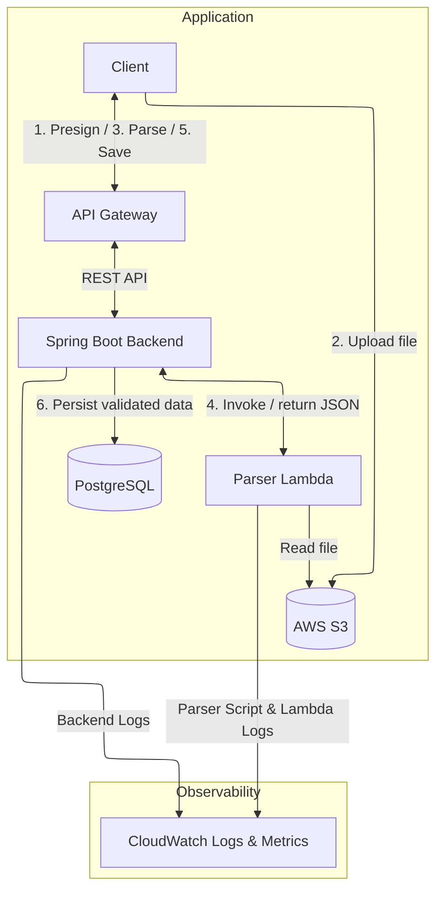

# Resume Engine MVP

## Project Overview

This is a standalone MVP built to test Become Consulting's resume parser.
It implements the end-to-end workflow in an isolated environment with its
own backend, database, and infrastructure, with the goal of integrating
the validated solution into the company's production backend and database.

## Documentation: /docs

### /docs/architecture.md
Basic System Architecture and core components

### /docs/API.md
API documentation

### /docs/database.md
Database schema

### /docs/workflows
Contains core data flow of two main backend workflows: Resume Parsing & RAG