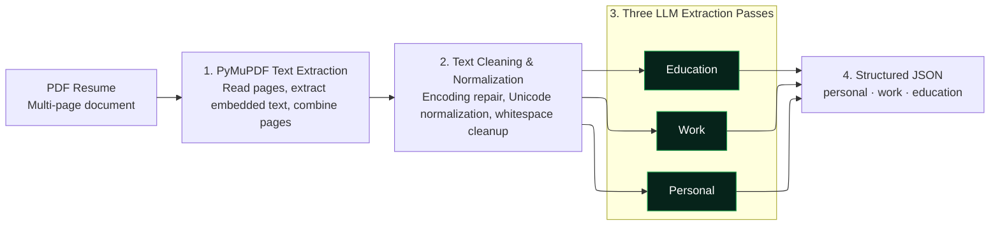

# Lambda Parser 

This directory contains the python script that parses the resume PDFs into 
structured JSON fields. Containerized and deployed on AWS Lambda.

## Architecture and Flow

## Testing Locally
1. Navigate to directory: `cd resume-parser-lambda`
2. Create virtual environment: `python3.12 -m venv .venv`
3. Activate .venv (mac): `source .venv/bin/activate`
4. Install Dependencies: `pip install -r requirementsDocker.txt`
5. Configure environment variables: 
   - OPENAI_API_KEY=your-api-key
   - OPENAI_CHAT_MODEL=your-gpt-model(default gpt-4.1-mini)
6. Add your test resume in the /data directory, and configure `line 280` in main.py 
to match your test file's name: `result = extract_text_from_resume("data/A5.pdf")`
7. run main.py: `python main.py`

## CI/CD to Lambda 
### AWS Setup: Docker --> ECR --> Lambda
#### 1. ECR Setup:  
       - ECR repository name: parser1
       - Root account: xudage2011@gmail.com
       - Region: ap-southeast-1 (!! ECR repository must be in same region 
         as Lambda !!)
       - Repository URI: 046491879086.dkr.ecr.ap-southeast-1.amazonaws.com/parser1
       - Permissions: LambdaECRImageRetrievalPolicy (allows lambda to pull 
         from this repo)
#### 2. Lambda Setup:
       - Name: lambda-parser1
       - Spec: 3008 MB memory, 512 MB storage, 2 min timeout 
       - Permissions Role: lambda-parser1-role-jpz5q91f (S3 access, Cloudwatch Logging)
#### 3. GitHub Actions AWS Authentication OIDC
       - Identity Provider: token.actions.githubusercontent.com (github default)
       - IAM role: ResumeParserGithubDeploy (EC2 and Lambda full access)
#### 4. CI/CD workflow:  
      see /.github/workflows/lambda_deployment.yml