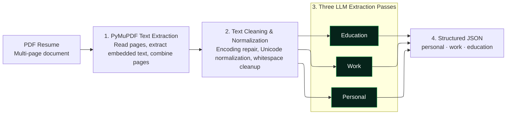

# Lambda Parser 

This directory contains the python script that parses the resume PDFs into 
structured JSON fields. Containerized and deployed on AWS Lambda.

### Architecture and Flow

### Testing Locally
1. Navigate to directory: `cd resume-parser-lambda`
2. Create virtual environment: `python3.12 -m venv .venv`
3. Activate .venv (mac): `source .venv/bin/activate`
4. Install Dependencies: `pip install -r requirementsDocker.txt`
5. Configure environment variables: 
   - OPENAI_API_KEY=your-api-key
   - OPENAI_CHAT_MODEL=your-gpt-model(default gpt-4.1-mini)
6. Add your test resume in the /data directory, and configure `line 280` in main.py 
to match your test file's name: `result = extract_text_from_resume("data/A5.pdf")`
7. run main.py: `python main.py`